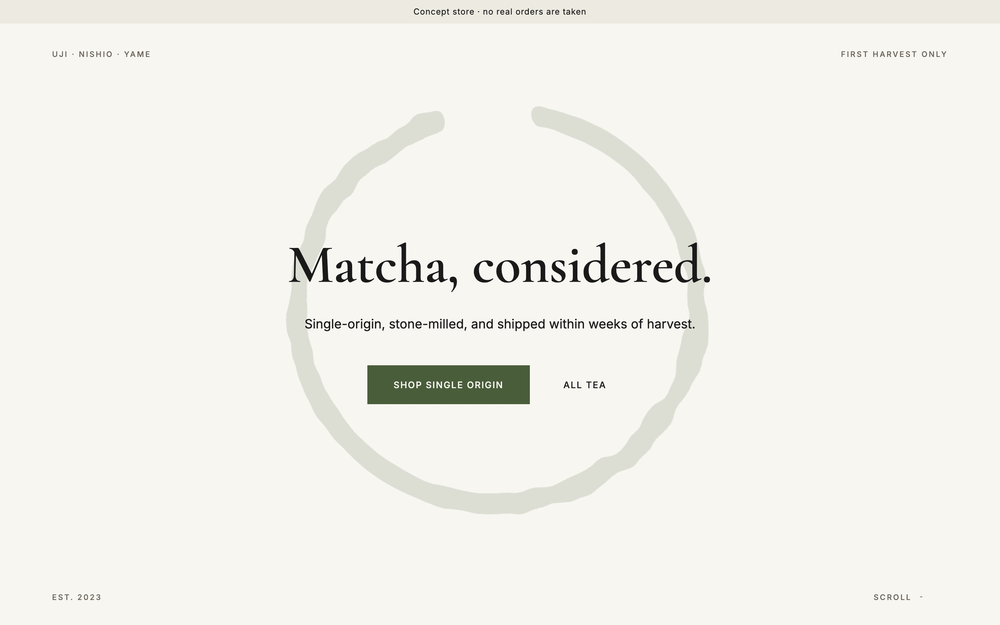

# Kohaku

A storefront for Kohaku, a single-origin matcha brand I designed, rebuilt from WordPress and WooCommerce as a custom Astro site.

> **Concept project.** Kohaku is not a real business. Checkout runs in Stripe **test mode**, so no real payments are taken. Use card `4242 4242 4242 4242` with any future date and CVC to try it.

**Live site:** https://shopkohaku.com
**Original WordPress version:** retired on 24 November 2026; its Lighthouse reports are kept in [`docs/baseline/`](docs/baseline/).



---

## Why I rebuilt it

The first version of Kohaku was built with WordPress and WooCommerce. It looked the way I wanted, but I didn't control most of the code behind it. I rebuilt it to:

- understand everything the site does, from product pages to checkout;
- make it faster and lighter by sending only the code each page needs;
- practise the migration on my own project before doing the same for two business sites.

## Before and after

| | WordPress version | This version |
|---|---|---|
| Platform | WordPress + WooCommerce | Astro + TypeScript |
| Hosting | Hostinger (LiteSpeed cache) | Vercel |
| Content | Database, edited in wp-admin | Markdown and JSON files in this repo |
| Checkout | WooCommerce | Stripe Checkout (test mode) |
| Lighthouse performance (mobile, home) | 92 | 100 |
| Lighthouse accessibility / SEO (mobile, home) | 96 / 92 | 100 / 100 |
| Largest contentful paint (mobile, home) | 3.0 s | 0.9 s |
| Requests (home) | 37 | 11 |
| Home page weight | 302 KB | 277 KB |

_Measured with PageSpeed Insights (Lighthouse 13.6), mobile preset, median of 3 runs: WordPress on 19 November 2026, this version on shopkohaku.com on 24 November 2026. All four measured pages are in [`docs/baseline/`](docs/baseline/)._

## Stack

- **[Astro](https://astro.build)**: builds each page to static HTML. JavaScript only loads for the parts that need it, such as the cart.
- **TypeScript**: types for products, variants and cart items.
- **Content collections**: products and journal posts live as files and are validated against a schema at build time.
- **Stripe Checkout**: hosted payment page; a webhook confirms paid orders.
- **Vercel**: every push to `main` deploys to production, and every branch gets a preview. Pages are static; only `/api/checkout` runs as a serverless function, through the `@astrojs/vercel` adapter.
- **Python**: a one-off script that exported products and posts from the WordPress REST API.

## How it works

```
Browser ──> Static pages (Astro, built at deploy time)
   │
   └─ Cart (client-side) ──> /api/checkout ──> Stripe Checkout
                                                   │
                         /api/stripe-webhook <─────┘  (payment confirmed)
```

## Project structure

```
src/
  assets/          # product and journal images, optimised at build time
  content/
    products/      # one JSON file per product, with variants and prices
    journal/       # Markdown journal posts
  components/      # Header, ProductCard, Cart, ...
  layouts/         # shared page layouts
  pages/           # routes: /, /shop, /product/[slug], /journal/[slug], ...
  pages/api/       # checkout and Stripe webhook endpoints
scripts/
  export_wordpress.py   # migrates content out of WordPress
public/            # static files served unchanged, such as favicons
docs/
  decisions.md     # notes on the main technical choices
  screenshots/
```

## Running it locally

Requirements: Node.js (LTS) and a Stripe account in test mode.

```bash
git clone https://github.com/Francisco-Abelha/kohaku.git
cd kohaku
npm install
git config core.hooksPath .githooks   # blocks direct pushes to main (see .githooks/pre-push)
cp .env.example .env    # add your Stripe test keys
npm run dev             # http://localhost:4321
```

Environment variables (see `.env.example`):

| Variable | Purpose |
|---|---|
| `STRIPE_SECRET_KEY` | Stripe **test** secret key (`sk_test_…`). Checkout refuses any other kind. |
| `STRIPE_WEBHOOK_SECRET` | Signing secret of the webhook endpoint (`whsec_…`). Optional: without it, checkout works but the webhook answers 500. |

To try the checkout, pay with Stripe's test card `4242 4242 4242 4242`, any future expiry date and any CVC.

## Migrating content from WordPress

`scripts/export_wordpress.py` reads products and posts from the old site's REST API and writes them into `src/content/`.

```bash
python3 scripts/export_wordpress.py --site https://shopkohaku.com --out src/content
python3 scripts/export_wordpress.py --skip-fetch    # convert again from raw/, no requests
python3 -m unittest discover -s scripts             # tests for the conversions
```

It only sends GET requests to public endpoints, and it is safe to re-run. Step 1 saves the API responses unchanged in `raw/` (gitignored). Step 2 converts them and downloads the images into `src/assets/`, listing each one's source in [`docs/image-sources.md`](docs/image-sources.md).

Products, categories and journal posts keep their WordPress URLs, so existing links keep working without redirects.

## Decisions and trade-offs

The main ones are written up in [`docs/decisions.md`](docs/decisions.md):

- **Astro instead of Next.js**: the site is mostly content, so static pages with a small interactive cart fit better than a full React app.
- **Files instead of a CMS**: as the only editor, I'm happy editing files. A business site would need a CMS so the owner can update it without me.
- **Stripe Checkout instead of a custom payment form**: Stripe handles card data and payment security.

## What I'd do next

- [ ] Add a headless CMS so non-developers can edit products
- [ ] Save orders from the webhook to a database
- [ ] Automated tests for the cart and checkout flow

## Credits

Brand, design and code by Francisco Abelha.
Photography: _[source and licence for each image]_
